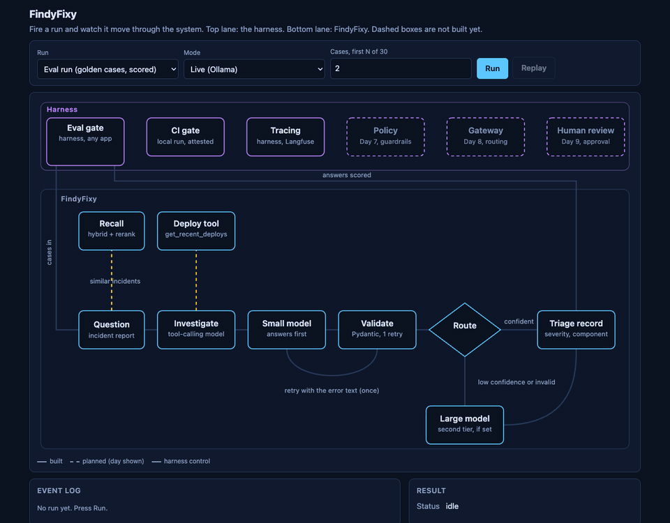
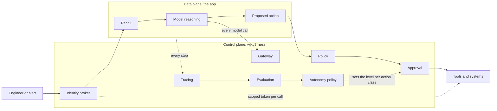

# Release and runtime controls for LLM applications

wyld3rness is a harness that measures an LLM app's answers before a change ships and records every run, without relying on the model to behave. It is tested on FindyFixy, an event detection, determination and mitigation agent in this repository. Everything runs on one machine with open-source models and synthetic data.



## Built

- **Eval gate and CI gate.** The app answers golden test cases, and the gate fails on a measured regression against a frozen baseline. A passing local run writes an attestation, and CI refuses any change to an answer-affecting file that no passing run covers.
- **Tracing.** Every run is an OpenTelemetry trace in a self-hosted Langfuse, with scores and a cost on each model call. A slow or stopped backend does not slow a run, and runs with tracing on scored identically.
- **One interface.** An app plugs in through three methods, and a test fails if the harness imports it.

## Target design



Tracing and Evaluation are built; the other checkpoints are planned. Details: [design](code/docs/design.md), [strategy](code/docs/strategy.md).

## Run it

You need [uv](https://docs.astral.sh/uv/), Docker Compose with a runtime (Colima or Docker) and [Ollama](https://ollama.com/). Plan for 16 GB of memory and about 8.5 GB of model downloads.

```bash
cp code/examples/findyfixy/.env.example code/examples/findyfixy/.env    # model names; edit if you use other models
make setup                        # once per clone: packages, models, database, incidents
make up                           # start the database
make console                      # then open http://127.0.0.1:8765
make down                         # when you are done
```

`make setup` is safe to run again.

Then, in the page, pick Triage run or Eval run and press Run. Fake mode needs no model.

```bash
make triage           # triage five fixed questions in the terminal
make eval             # score FindyFixy on 30 golden cases through the harness (live models, minutes)
make case ID=g07      # one case end to end: the alert, the answer, every judge decision
make test             # the harness and FindyFixy tests (make test-harness: the harness alone)
make obs-secrets      # once: secrets for the local Langfuse stack
make obs-up           # then open http://127.0.0.1:3000 to see every run as a trace
make obs-prices       # once per stack: reference prices, so every model call carries a cost
make help             # everything else
```

## Docs

[Strategy](code/docs/strategy.md) · [Design](code/docs/design.md) · [Decision records](code/docs/adr/README.md) · [Changelog](code/CHANGELOG.md) · [Harness](code/src/wyld3rness/README.md) · [FindyFixy](code/examples/findyfixy/README.md) · [Workspace](code/README.md) · [Infrastructure](code/infra/README.md) · [Checks](tools/README.md) · [Hooks](.githooks/README.md) · [Contributing](CONTRIBUTING.md)

<details>
<summary>Disclaimer</summary>

This software and its documentation are provided "AS IS", without warranty of any kind, express or implied, including but not limited to warranties of merchantability, fitness for a particular purpose, accuracy and non-infringement. It is a research prototype and is not intended for production use or for decisions about real systems, incidents, safety or finances. Model outputs can be wrong, and the measurements here describe one setup on synthetic data.

To the maximum extent permitted by law, the author and contributors are not liable for any claim, damages or other liability, whether in contract, tort or otherwise, arising from or in connection with the software, its use or its documentation, including direct, indirect, incidental, special, consequential or other loss. You use it at your own risk and are responsible for reviewing, testing and securing anything you run. This section does not replace the warranty disclaimer and limitation of liability in sections 7 and 8 of `LICENSE`, which govern.

</details>

## License

Apache-2.0. See `LICENSE` and `NOTICE`. Contributions are licensed under the same terms; see `CONTRIBUTING.md`.

---

made with ❤️ in  Seattle by [wyld3rbit.ai](https://wyld3rbit.ai)
