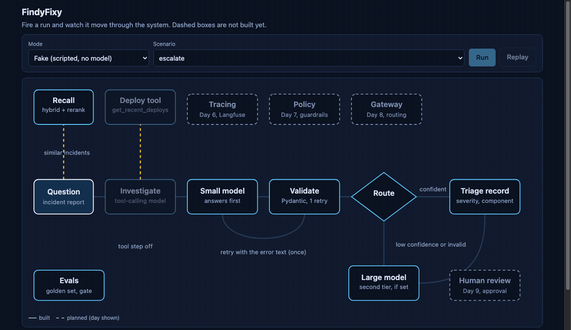

# FindyFixy



*A live run in the visualizer (`make console`, real models through Ollama, escalation forced). The dot is the request moving through each step. The waiting stretches are sped up; the console was warmed first.*

FindyFixy is a prototype that tests whether all three levels of AI-assisted engineering are reachable today with an open-source harness. At Level 1 an AI writes code, and humans review, deploy and maintain it. At Level 2 the AI also reviews the code with agent judges or deterministic rule sets and deploys it once a human says OK, while humans respond to incidents with AI-augmented discovery. At Level 3 the AI also rolls back and rolls forward, writes postmortems and makes any change a human problem-solver would, under the same kind of risk controls.

The harness is the part being built: the evaluations, gates, guardrails, tracing and cost limits that decide what an AI system may do on its own. FindyFixy is the system inside it, an event detection, determination and mitigation agent. An engineer pastes in an incident report, and it returns a severity, the likely component and a first action, along with the most similar past incidents and what fixed them. It can route a weak answer to a larger model, though the default setup uses one model, because the measurements below showed that a model's own confidence did not predict its errors.

The project advances one control at a time, and each step is measured before the next begins. The router came first, then validated output, tools, memory, hybrid retrieval, and an answer-quality gate that fails the build when answers get worse. The results in this README come from those runs, with their limits stated beside them. Tracing, guardrails, cost budgets and approval for risky actions are still ahead.

Everything runs on 1 machine with 16 GB of memory provisioned, uses open-source models, and reads only synthetic data. The code is licensed under Apache-2.0. The decision records in `docs/adr/` explain each phase, and every folder has a README that says what it is for.

## Quick start

You need [uv](https://docs.astral.sh/uv/), Docker Compose with a runtime (Colima or Docker) and [Ollama](https://ollama.com/).

```bash
cp code/.env.example code/.env    # model names; edit if you use other models
make setup                        # once per clone
```

> `make setup` installs packages, pulls the models named in `.env` (about 7 GB), starts the database and loads the incidents. It is safe to run again.

Every session, from this folder:

```bash
make up         # start the database (skip it for fake runs and the tracker)
make ui         # then open http://127.0.0.1:8766
make down       # when you are done
```

`make ui` serves one page. The tracker is the page, and the live visualization is embedded at the top. Ctrl-C stops it.

## Usage

```bash
make console          # live page: watch each step run
make ui               # one landing page: http://127.0.0.1:8766
make triage           # triage five fixed questions
make eval             # score the assistant on 30 test cases (live models, minutes)
make case ID=g07      # one case end to end: the alert, the answer, every judge decision
make eval-gate        # exit 1 if answers got worse than the frozen baseline
make eval-retrieval   # compare the three retrievers
make test             # the product tests
make help             # everything else
```

Each triage run prints one record and how it was made:

```
A: <severity> | <component> | <next action>
model: <small or large model> | confidence: <0 to 1> | latency: <seconds>
```

## How it works

```
report
  -> Recall        hybrid search over past incidents, reranked, top 3
  -> Investigate   tool call: recent deploys for the service
  -> Answer        one model drafts the triage record
  -> Gate          confidence >= 0.7: answer
                   otherwise: a second model, if one is configured
```

| Layer | Implementation |
|---|---|
| Orchestration | LangGraph |
| Model | Ollama: Qwen3 4B-instruct (`SMALL_MODEL`). Set `LARGE_MODEL` to a different name for a second tier; the same name means one model and no escalation. |
| Decoding | Temperature 0, thinking off, 120 s read timeout. The same alert gets the same triage. |
| Output contract | Pydantic record, validated in code. One retry that carries the validation error. At most 2 calls per model. |
| Memory | Postgres 16 with pgvector. 200 synthetic incidents, 800 chunks, `bge-small-en-v1.5` embeddings (384 dimensions). |
| Retrieval | BM25 top 50 and vector top 50, fused with Reciprocal Rank Fusion (k=60), reranked by `bge-reranker-base`. Each recalled incident carries its severity and its fix. |
| Tools | `get_recent_deploys`, served over MCP (stdio). |
| Judge | Qwen2.5 7B (`JUDGE_MODEL`), a different family from the answering model. |

Routing is a policy, not a model property. A model's confidence is text it writes, so the 0.7 threshold only matters when two models are configured.

## Results

Every number comes from a recorded run, and the limits are listed with them.

**Choosing the model.** One model answers all 30 test cases, at temperature 0, thinking off, with the same judge. A case counts as right when the severity matches the reference.

| Model | Severity right | Most serious (sev1) caught | Median per case | Memory |
|---|---|---|---|---|
| Qwen3 4B-instruct | 25 of 30 | 6 of 8 | 4.6 s | 2.5 GB |
| Qwen3 8B | 26 of 30 | 7 of 8 | 7.9 s | 5.2 GB |
| Qwen2.5 7B | 20 of 30 | 2 of 8 | 3.4 s | 4.7 GB |
| Qwen2.5 1.5B | 10 of 30 | 2 of 8 | 1.5 s | 1.1 GB |

The 4B and 8B differ by one case, which 30 cases cannot separate, so the 4B is the default at about 58 percent of the 8B's time and half its memory. With the 1.5B, the model's own confidence never flagged its mistakes (at most 1 of 30 cases escalated in any run), so small-first routing saved nothing there.

**Answer quality on the final setup** (Qwen3 4B-instruct, severity and fix in the recalled incidents, 30 cases, 95 percent intervals):

| Measure | Score | What it asks |
|---|---|---|
| Severity right | 0.77 [0.60, 0.90] | Does the severity match the reference? |
| Faithfulness | 0.79 [0.70, 0.87] | Is each claim supported by the recalled incidents? |
| Context recall | 0.93 [0.86, 0.98] | Does the recalled text contain what the reference says? |
| Action quality | 0.92 [0.82, 0.98] | Would the proposed first action help? 26 of 30 rated helpful. |
| Response relevancy | 0.67 [0.64, 0.69] | Does the answer address the question? |

How to read these:

- The test cases are the alert line only, with the case's own incident removed from recall, so the assistant cannot read the answer. The paired incident was recalled in 19 of the 20 cases that have one.
- The corpus is templated and its severities are random within each failure pattern. Absolute scores flatter; compare runs, not the outside world.
- Context recall rose after past fixes were added to the recalled text, partly because the reference also states the fix. It shows the text is present, not that retrieval improved.
- The judge is a 7B model and tends to be lenient. Check scores with `make case`.
- With 30 cases, one case moves a rate by 3 points. Differences of a few points are noise. The same model scored 25 of 30 in the model comparison and 23 of 30 here, after the recalled text changed.
- Recall is what carries the result. With it removed, the same test falls to 0.17 on severity and 0.10 on action quality, and the release gate fails on all eight of its checks.

**Retrieval.** 40 labelled queries: 30 paraphrases of known incidents, 10 exact hostnames.

| Retriever | recall@5 | recall@5, hostnames | MRR | p50 latency |
|---|---|---|---|---|
| Vector | 0.93 | 0.70 | 0.823 | 14 ms |
| Hybrid | 0.97 | 0.90 | 0.821 | 15 ms |
| Hybrid + rerank | 1.00 | 1.00 | 0.781 | 341 ms |

- Embeddings miss exact tokens. BM25 recovers most of that. The reranker recovers the rest at about 24 times the latency.
- The reranker lowers MRR. Near-duplicate incidents fill two of the three recall slots. Not fixed.
- recall@5 is the share of queries with at least one correct incident in the top 5. MRR is the mean of 1 / rank of the first correct one.

**Two earlier findings, both with the 1.5B model.** A valid tool call can still be wrong: it asked the deploys tool for a 1-hour window on a 24-hour question in 30 of 30 runs, a legal call that was right 0 of 30 times. And MCP costs process starts, not tokens: 499 input tokens on every path, with a median of 0.57 s direct or over a persistent session and 1.14 s with a new session per call.

## Decisions

| Decision | Alternative rejected | Reason |
|---|---|---|
| One answering model, Qwen3 4B-instruct | A small-first router with a second tier | Within noise of the 8B at 58 percent of the time, and the small model's confidence did not predict its errors. |
| Temperature 0 and a read timeout on every answering model | Ollama's default sampling | The same configuration scored 9, 11 and 16 of 30 on severity across three runs. A repeatable gate needs a repeatable system. |
| Test cases are the alert line only | The full report | The summary and timeline state the cause and the fix, so the model would read the answer. |
| Evaluate with each case's own incident held out of Recall | Leave it in the index | Recall would return the answer key and every metric would read high. |
| Show each recalled incident's severity and fix | Summary and cause only | The twin's severity was in the archive and never shown. The fix is what a concrete next action comes from. |
| Write the judge metrics in-house, with a separate action-quality measure | The `ragas` library | An unfixed security advisory (PYSEC-2026-3046) and 31 new packages in a release gate. Faithfulness scores advice near zero by construction. |
| The gate never rewrites its own baseline, and refuses an untraceable one | Trust whoever runs it | A failing run saved as the baseline would make the next run pass. |
| Commit hooks run the checks, and a drift check rejects docs that name missing files | Rules written in a document | A rule that can be forgotten will be. |
| 7-day delay on new package releases, vulnerability audit on every lock change | Latest versions | Fresh releases are where hijacks land. |
| Pin container images by digest and scan with Grype | Tags only | The database image carried 8 critical and 37 high findings in OS packages. Accepted for local use with synthetic data. |

## Status

**Built:** routing, validated output, tools over MCP, ingestion, hybrid retrieval with rerank, the Recall step with severity and fixes, a labelled retrieval evaluation, and the answer-quality evaluation with a frozen baseline and a release gate. Logic is tested with fakes, and new logic was broken on purpose to confirm the tests fail.

**Not yet:** tracing, prompt-injection defences, cost budgets, approval for destructive actions and a one-command demo are not built.

## Notes

- Secrets go in `code/.env`, which is git-ignored.
- `code/CHANGELOG.md` records what changed and what is open.
- Built with Claude Code.

## Disclaimer

This software and its documentation are provided "AS IS", without warranty of any kind, express or implied, including but not limited to warranties of merchantability, fitness for a particular purpose, accuracy and non-infringement. It is a research prototype and is not intended for production use or for decisions about real systems, incidents, safety or finances. Model outputs can be wrong, and the measurements here describe one setup on synthetic data.

To the maximum extent permitted by law, the author and contributors are not liable for any claim, damages or other liability, whether in contract, tort or otherwise, arising from or in connection with the software, its use or its documentation, including direct, indirect, incidental, special, consequential or other loss. You use it at your own risk and are responsible for reviewing, testing and securing anything you run. This section does not replace the warranty disclaimer and limitation of liability in sections 7 and 8 of `LICENSE`, which govern.

## License

Apache-2.0. See `LICENSE` and `NOTICE`. Contributions are licensed under the same terms; see `CONTRIBUTING.md`.


---

made with ❤️ in  Seattle by [wyld3rbit.ai](https://wyld3rbit.ai)
