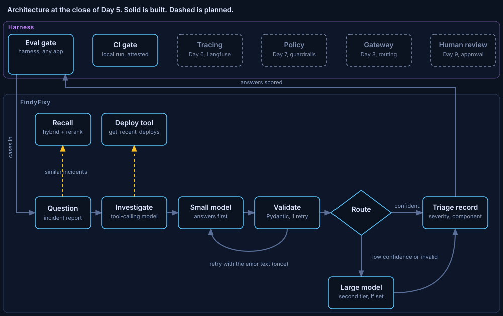

# ADR 0006: The eval gate is a harness component, attested in CI

Status: accepted. Written 2026-11-09, in the commit that closes the rebuilt phase.
Phase: Day 5, rebuilt. It supersedes the layout in [ADR 0005](0005-gate-releases-on-measured-answer-quality.md), whose policies on the judge, holdout, failures and baseline still hold. Code at close: the commit that adds this record. Run data: the Results section of [lessons/d05.md](../../../lessons/d05.md).

## Decision

The answer-quality gate is a harness component that any app plugs into through one interface. FindyFixy is its first consumer. A full local run that passes writes an attestation, and CI fails any pull request that changes an answer-affecting file without a matching passing attestation.

## Diagnosis

The harness is the product and FindyFixy is the app it is tested on. The first gate read FindyFixy types directly (`Triage`, `Prior`, `build_graph`, the router threshold), so no second app could use it. It also ran only by hand: nothing stopped a change that skipped it. A full live run needs about 300 to 400 model calls on a 4B and a 7B model, which hosted CI runners without a GPU cannot do in reasonable time.

## Guiding policies

1. The harness never imports the app. A test fails on any `app` import under `code/harness/`, and relative imports are banned so the check sees every edge.
2. One seam: `SystemUnderTest` with `describe`, `answer` and `summarise`. The app supplies cases and answers; the harness owns the judge, metrics, statistics, reports, baseline, gate and attestation.
3. A move must not move a score. The saved reports of 2026-10-26 gate the same way under the new code before anything else changes.
4. The expensive run happens where the models run fast; the cheap check runs in CI. The attested files are computed from the eval's import closure plus declared data, lock and compose files, never listed by hand.
5. An attestation is written only for a full, comparable, non-control pass on a clean tree with a known judge digest and a current database.
6. Adopt an established open-source blueprint before building custom code, from Day 6 on.

## Coherent actions

- Done: `code/harness/eval/` with the seam, runner, events and CLI; `app/eval_adapter.py`; the equivalence proof.
- Done: `harness/eval/attest.py` (standard library only), `make eval-gate` writing `evals/attestation.json`, `make verify-attestation`, and a CI job that verifies first and alone, then the product tests.
- Done: the visualizer shows a harness lane and a live Eval run mode; tests fail if a box claims code that does not exist.
- Done: batched judge verdicts were measured and rejected (Evidence).
- Open: answer first and judge after, with per-phase timing, to cut run time without changing scores (Day 6).
- Open: the learner's own hand-check of three judged cases.

## Build, buy or adopt

Eval gate: built, and kept. Inspect AI (MIT, UK AISI) and promptfoo (MIT, owned by OpenAI since March 2026) were the off-the-shelf alternatives. Rebuilding on them would cost a day for no measured gain, and neither provides the bootstrap intervals, frozen baseline and attestation as they are.
CI: adopted. GitHub Actions on `pull_request`, read-only token, no secrets, actions pinned by commit SHA.
GPU CI runner: rejected for now. Paid per minute; the attestation is the cheaper control for one developer.
Self-hosted runner on the developer machine: rejected. Code from any pull request would run on it in a public repository.

## Staffing

No hire. One engineer and one AI coding agent. The agent's work was bounded by the build harness: plan before code, sub-agents for scoped packages, the lead's own verification, and a fresh-agent code review before every commit. Three reviews raised 30 findings across the harness move, the visualizer and the CI gate, and all were fixed before commit.
Add people when more than one developer produces attestations, because the attestation trusts the person who ran it.

## What would change this

A second developer, or anyone outside the project, needing to trust a merge: replace the attestation with a real run on a GPU runner. A judge prompt change or a new judge model: re-freeze the baseline deliberately. A golden set larger than 30 cases: revisit the floors.

## Evidence

Equivalence of the move, using the saved reports: the final run `eval-20261027T044126Z` passes the gate; the no-recall control `eval-20261027T044746Z` fails with the same 8 messages in the same order; re-freezing the final run reproduces `evals/baseline.json` byte for byte.

First attested run, report `eval-20261110T025827Z` at `b1fe199`, Qwen3 4B-instruct answering and Qwen2.5 7B judging, 30 of 30 cases, 0 run errors, gate pass:

| Measure | Mean | 95% interval | Judge failures |
|---|---|---|---|
| severity match | 0.77 | 0.60 to 0.90 | 0 |
| faithfulness | 0.79 | 0.70 to 0.87 | 0 |
| response relevancy | 0.67 | 0.64 to 0.69 | 3 |
| context recall | 0.93 | 0.86 to 0.98 | 0 |
| action quality | 0.92 | 0.82 to 0.98 | 0 |

The paired incident was recalled in 95% of twin cases. Wall time 846.4 s, 2.13 cases per minute. The attestation covers 38 files.

Batched judge verdicts, re-judging the saved per-item verdicts of that run with one call per case: faithfulness agreed on 0.839 of 143 claims (Cohen's kappa 0.52); context recall agreed on 0.917 of 72 sentences (kappa 0.53) but moved the case mean by minus 0.059, and one batch came back malformed. The bar set before the run was 0.9 agreement. Rejected; one judge call per item stays.

## Limits

30 cases, synthetic, local models. One live run of the gate. The attestation is a process control: a pull request can edit the checker or the attestation, and branch protection with review is the real control. A stale database is refused, but a bumped embedding-model revision without a re-ingest still looks current. The batched-verdict comparison is against one per-item run, not per-item against itself.
