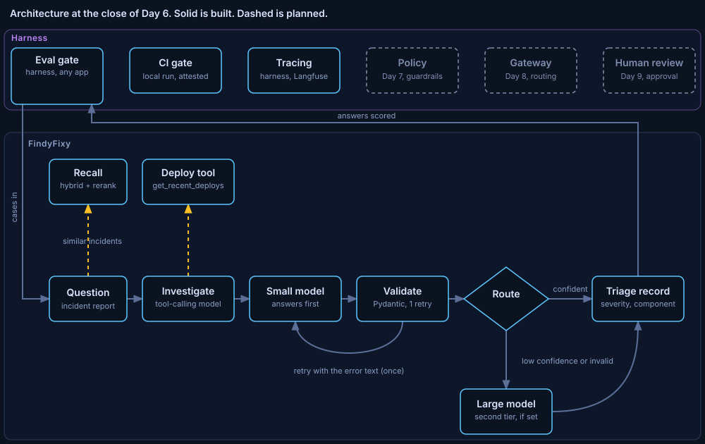

# ADR 0007: Every run is an OpenTelemetry trace in a self-hosted backend

Status: accepted. Written 2026-11-10, in the commit that closes the phase.
Phase: Day 6. Code at close: the commit that adds this record. Run data: the Results section of [lessons/d06.md](../../../lessons/d06.md).

## Decision

Tracing is a harness component. Every FindyFixy run, every eval case and every command that touches a model, the database, a tool or the network becomes one OpenTelemetry trace, sent to a self-hosted Langfuse. Eval scores sit on their case's trace, and every model call carries its tokens and a cost from a committed reference price table. Tracing never slows a run and never changes an answer or a score.

## Diagnosis

The eval report says how good the answers are, but not where a run spends its time or money, or why one case scored low. Before this phase, a low score meant re-running the case by hand with print statements. The eval run also took 846 s, and nobody knew which part of it was slow. A trace per run answers both questions: each step's inputs, outputs, latency and tokens, kept and searchable. The risk is the reverse dependency: a tracing backend that is slow or down must not slow the system it watches.

## Guiding policies

1. Instrument once, with the OpenTelemetry SDK and the GenAI semantic conventions. Langfuse is the backend, not the API: any OTLP backend reads the same spans. The few Langfuse-only attribute names are defined in one place.
2. The harness owns tracing and never imports the app. An app maps its own events onto spans through an adapter (`app/trace_adapter.py`).
3. A run never waits on tracing. Spans go out in batches from their own thread; a full queue drops spans instead of blocking; scores are sent in the background and dropped, never raised.
4. Tracing changes no number. Every gate run with tracing on was compared case by case with the attested run before it.
5. Measure before optimising. The load cost of each model was measured before the eval runner was split into an answer pass and a judge pass.
6. Unknown is not zero. A missing token count is left out, not sent as 0; a failed metric is an error on its span, not a score of 0.
7. Secrets stay out of code and logs. Keys come from the environment or the stack's own git-ignored file, the local keys never go to another host, and the config's `repr` hides the secret.

## Coherent actions

- Done: answer first, judge after, with per-phase timing; the wall time fell from 846.4 s to 663.4 s with identical scores.
- Done: the Langfuse v4.72.0 stack in `code/infra/langfuse/`, images pinned and scanned, ports on 127.0.0.1 only, Valkey in place of Redis for its license.
- Done: `harness/trace/` (tracing, spans, commands, scores, prices), the app's adapter, eval cases as traces with their scores, judge calls and recall stages as spans, every command as a trace, users and sessions.
- Done: the Tracing box on the architecture page, a link from each console run to its trace, models loaded from the local cache with no call to huggingface.co.
- Done: a reference price per token for each model, registered with Langfuse, which prices every model call it receives.
- Open (Day 7): harder, versioned incident data and an escalation signal the system computes. The three dashboard questions showed that the golden set never reaches the large model.
- Open: the cause of one slow judge pass (848 s against about 585 s in the other runs).

## Build, buy or adopt

Tracing API: adopted. OpenTelemetry (Apache-2.0) is the vendor-neutral standard, and its GenAI conventions name the model, token and operation attributes.
Backend: adopted. Langfuse (MIT outside `ee/`, which is not used), self-hosted from its official compose file with a short list of changes. Self-hosted because the project runs open source on one machine, so prompts and answers never leave it. Only v4 is used, because Langfuse removes its legacy APIs on 2026-11-16. No other backend was evaluated in this phase.
Langfuse's own SDK and the LangChain callback: not used. Both would tie the harness to one backend; the plain OpenTelemetry SDK does not.
Scores and prices: built, thin. OpenTelemetry has no standard for scores or prices, so `harness/trace/scores.py` and `harness/trace/prices.py` call Langfuse's own APIs behind a small interface each. Cost itself is computed by Langfuse at ingestion.

## Staffing

No hire. One engineer and one AI coding agent. The agent worked inside the build harness: a plan approved before each step, tests with fakes, each new test broken once on purpose, and an independent review before each commit. Reviews in this phase found real bugs before they shipped, among them nested tool spans that swapped results, scores lost when a sender thread died, local keys that could reach a remote host, and the test suite sending 48 traces to the live backend.
Add people when traces hold real user data: then retention, access control and redaction need an owner.

## What would change this

Real user data in prompts: add redaction before export and a retention policy. More than one machine or user: a shared backend with authentication beyond one key pair. A hosted model behind the gateway (Day 8): its real price replaces the reference price for that model. A trace volume the batch exporter drops under load: sampling, decided per route.

## Evidence

Step 1, answer first and judge after: report `eval-20261110T064445Z`, identical case by case to the attested run `eval-20261110T025827Z`. Wall time 846.4 s before, 663.4 s after (answer pass 84.3 s, judge pass 579.1 s). Each model load took 1.9 to 3.2 s, and the case-by-case order paid two loads per case.

Gate runs during the phase, each identical case by case to the one before: `eval-20261110T080005Z`, `eval-20261110T085644Z`, `eval-20261110T184932Z`, `eval-20261110T205517Z`, `eval-20261110T233234Z`, `eval-20261110T234417Z` with `qwen3:8b` as the large model, and `eval-20261111T003655Z` after the review fixes (attestation over 46 files). The scores, unchanged since ADR 0006: severity match 0.77, faithfulness 0.79, response relevancy 0.67, context recall 0.93, action quality 0.92.

The three dashboard questions, over the last two runs (60 FindyFixy runs), read through Langfuse's metrics API:

| Question | Answer |
|---|---|
| Cost per run, local only | $0.0000431 at the reference price ($0.05 and $0.40 per million input and output tokens) |
| Cost per run, escalated | not measured: 0 of 60 golden runs and 0 of 5 triage questions escalated |
| Judge cost per case | $0.00144, about 33 times one FindyFixy run |
| Slowest node at p95 | the small model's node, 3.12 s, against recall at 0.48 s; a whole run 3.54 s |
| Lowest faithfulness | g28 (0.17), g27 (0.4), g08 (0.4) in both runs |

Isolation: the test suite sends nothing to the live backend (57 traces before a full test run, 57 after). A hung exporter and a refused connection leave span creation fast (tests). 831 tests pass.

## Limits

One machine, local models, synthetic data. The reference prices are a yardstick borrowed from hosted models, not a bill, and they cover tokens only, not the machine. Cost is computed at ingestion, so traces stored before the prices were registered have none. No escalation happened, so the cost of the large-model path is still unmeasured; the self-reported confidence never fell below 0.7, even on g28, whose faithfulness was 0.17. The three low-faithfulness reasons are read from one trace each; g08 may be judge strictness and is not yet hand-checked. One run each side for every timing comparison, so the sizes of the time savings are anecdotes. Langfuse v4's events-only mode disables its score and trace read routes, so scores can be written but only read through the metrics API or the web page.
