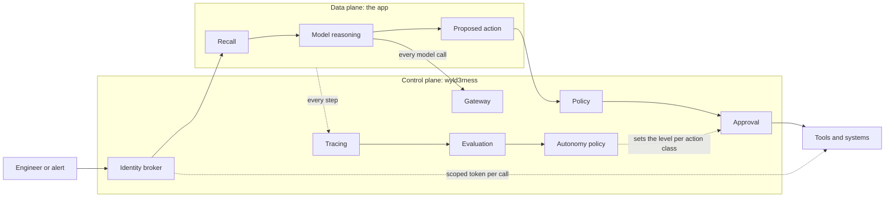

# Design: the harness as a control plane

This document is the target design of wyld3rness: the shape the transitions in [`strategy.md`](strategy.md) move toward. The ADRs in `adr/` record what each phase decided and built, and the strategy holds the diagnosis, the policies and the invariants. This page holds only the shape.

## The question

An LLM agent is a non-deterministic component inside a system that must behave deterministically where it matters. The same alert can produce a different answer on a different day, a retrieved document can carry instructions, and a confident answer can be wrong. The question the harness answers is how much an agent may do on its own, and on what evidence.

The answer this design gives: the agent never decides its own authority. Every request crosses a fixed set of checkpoints, each checkpoint enforces one invariant in code, and the authority each kind of action runs with is set by measured evidence, also in code.

## Two planes

The **data plane** is the app. FindyFixy, the example app, takes an incident alert, recalls similar past incidents, calls models and tools, and proposes a triage record with a next action. The data plane is where the model's judgement is used.

The **control plane** is the harness. It sits on every path in and out of the data plane: requests, model calls, tool calls, proposed actions, releases. It never relies on the model behaving. Each of its checkpoints is deterministic code that holds the same way for every request.

## Invariants

Each checkpoint enforces one invariant. The invariants, the policy behind each and the check that proves it are listed once, in the enforcements of [`strategy.md`](strategy.md#enforcements).

## One request, end to end

An engineer pastes an alert. The request carries the engineer's identity, which the broker uses for every later token. Recall reads past incidents from memory and marks them as untrusted data in the prompt. The model call goes through the gateway, which checks the budget, picks the model, and records tokens and cost.

The model proposes a triage record and an action. Schema validation rejects a malformed record, and the router escalates to the larger model when a computed signal, not the model's own confidence, says the answer is weak. Policy then checks the proposed action against facts the model cannot forge: the action is on the allow-list, the severity comes from the validated record, the deploy it wants to roll back exists in the deploy log.

If the action is allowed, its class decides what happens next. A read action runs. A destructive action runs at the level the autonomy policy grants its class: it waits for a human at Level 2, and runs with a human on the loop only at Level 3. Every tool call presents a token the broker issued for that one tool, resource and minute. Every step lands in the trace, and eval scores attach to the same trace.

## Autonomy as policy

The levels come from the series thesis. At Level 1 the agent advises and humans act. At Level 2 the agent acts after a human approves. At Level 3 the agent acts, and humans govern from on the loop, with the power to undo.

Autonomy is set per action class, not per agent:

| Class | Examples | Starts at |
|---|---|---|
| Read | recall, read logs, read metrics, list deploys | Level 3: runs freely |
| Reversible | page a human, open a ticket | Level 2 |
| Destructive | roll back a deploy | Level 1: proposed only |

A class moves up one level only when its evidence passes thresholds stored in code: the eval gate on the current golden set, 0 unauthorized actions in the injection suite, and an approval record in which humans agreed with the agent's proposals often enough over enough cases. A regression in any of them moves the class down without a human decision. The thresholds are set from measured data in Day 10, not guessed in advance.

## How an app plugs in

The harness never imports the app. Each control is a port the app implements or calls:

- `SystemUnderTest` (built): describe, answer, summarise. The eval gate runs the app through it.
- The event adapter (built): the app reports its steps, and the harness turns them into spans.
- The action port (Day 7): the app declares its actions, their classes and the facts policy checks.
- The model port (Day 8): the app asks the gateway for a completion and never holds a model client.
- The approval port (Day 9): the harness pauses a run and resumes it on an approval record.

Dependencies point inward: the harness defines the ports, the app depends on them, and one composition root in the app wires the real implementations.

## Two harnesses

This design is the runtime harness: what ships around the app. The build harness is how the coding agent is constrained while it writes the code: the rules in `CLAUDE.md`, the pre-commit hooks, the privacy scan, plan-before-code, and a fresh-agent review before each substantial commit. Both are named in every write-up, because the word harness means the second one to many readers.

## What this design does not cover

It is one machine, one engineer and synthetic data. Multi-tenant isolation, high availability, data retention and a real identity provider are named where they would change a decision, and are not built. The judge is a model too, so the eval gate measures agreement with a judge, which is itself checked by hand on sampled cases.
