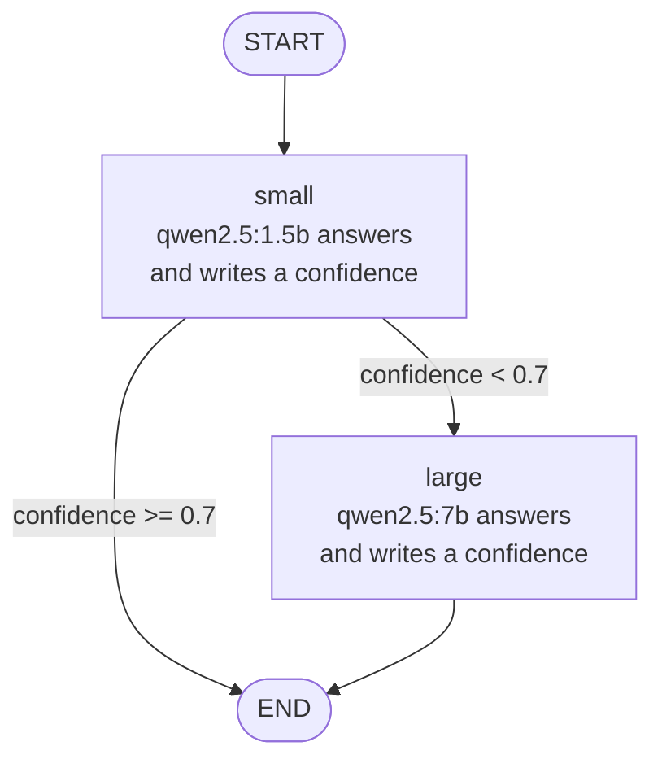

# Router graph

Small model first. The larger model runs only when the small one is not confident.

## State carried between nodes

- `question`
- `answer`
- `confidence`
- `model_used`

## Notes

- Source: `app/graph.py`. The threshold is `THRESHOLD = 0.7`.
- This diagram is hand-drawn, and it now matches what LangGraph itself draws. Before the refactor, `draw_mermaid()` left out the `small -> large` edge, because `route()` had no `Literal` return type. That is fixed, and `tests/test_routing.py` fails if it regresses.
- To get LangGraph's own drawing: build the graph with `build_graph(...)` and call `.get_graph().draw_mermaid()`. Dotted arrows are conditional edges.
- Routing is tested in `tests/test_routing.py` with a fake model function. Run `uv run pytest`.
- Confidence is the number the model writes in its answer. It is not an Ollama score and has no fixed range.
