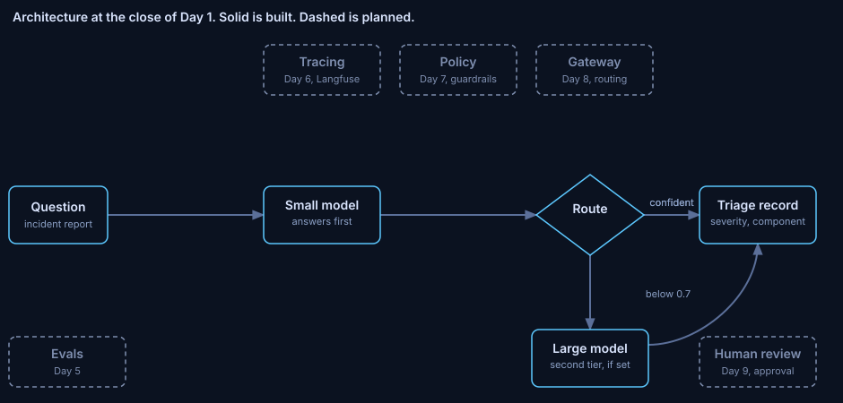

# ADR 0001: Route on a small model first and distrust its confidence

Status: accepted. Written 2026-10-29, after the phase closed, from the phase notes, the changelog and the decision log.
Phase: Day 1. Code at close: commit `853532b`. Run data: [notes/day1.md](../../notes/day1.md).

## Decision

A small model answers first. A large model answers when the small model's confidence is below 0.7. No routing rule goes live on that confidence until it is measured against answer correctness.

## Diagnosis

The routing rule sets how often the 7B model is called. It is the main cost lever. Its only input is a number the 1.5B model writes about itself.

In 5 runs the number used two scales. 0.8 and 0.742 on 0 to 1. 75, 90 and 95 on 0 to 100. 0 of 5 questions escalated. Mean latency was 2.9 s against a 5 s target.

The ratings did not follow quality. 90 went to an answer that called HTTP 429 a "condition code". 75 went to an introduction with no checks. 0.742 went to an answer with no steps.

## Guiding policies

1. No routing rule goes live on a signal that has not been measured against correctness. Cost: a slower start.
2. Output outside the contract goes to the larger model.
3. The escalation rule is a pure function of recorded values. It tests without a model.

Signals named in the notes and not tested: rules, retrieval score, a judge model, token probabilities.

## Coherent actions

- Done: the router graph with the 0.7 threshold. Routing tests use a fake model function.
- Day 2: a validator that rejects out-of-range confidence, with one retry.
- Day 5: an evaluation gate that fails the build when answer quality drops.
- After a labelled test set exists: a measured signal replaces the self-reported number.

## Build, buy or adopt

Routing rule: built. It is short and encodes a product decision.
Orchestration: adopted. LangGraph, open source.
Routing gateways: sold by vendors. The comparison waits for cost data (Day 8).

## Staffing

No hire. One engineer and one AI assistant built the phase.
Add people when gates fail builds faster than anyone can investigate them.
Add people when a second system needs the same controls and the harness needs an owner.

## What would change this

A confidence signal that predicts correctness on a labelled test set reverses policy 1.

## Evidence

- Models: `qwen2.5:1.5b` (small), `qwen2.5:7b` (large). Threshold 0.7.
- The first run failed on question 2: the model wrote a confidence of 75.
- Second run, 5 questions: confidence 75.0, 0.8, 90.0, 0.742, 95.0. Latency 2.8, 4.7, 1.5, 1.2 and 4.2 s.
- Ollama's structured outputs page does not say whether numeric bounds are enforced during generation. The range check was removed and the code notes that any value above 1 passes the 0.7 test.

## Limits

5 questions. 1 run. 1 model. 5 runs give no p95. Whether stated confidence matches how often answers are correct (calibration) is not measured.
