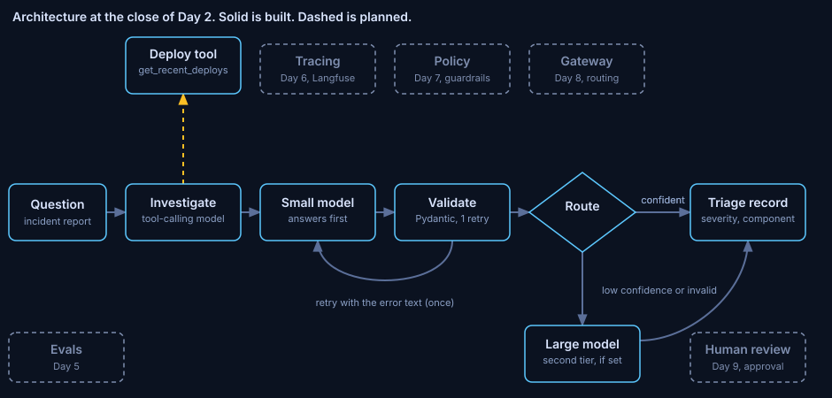

# ADR 0002: Validate every model output and every tool argument

Status: accepted. Written 2026-10-29, after the phase closed, from the phase notes, the changelog and the decision log.
Phase: Day 2. Code at close: commit `5262b5b`. Run data: [notes/day2.md](../../notes/day2.md).

## Decision

Model output is a typed Triage record. An invalid reply gets one retry that carries the validation error. Tool arguments are validated inside the tool as well as at the wrapper. MCP was measured against a direct call before it carried a tool.

## Diagnosis

Day 1 let a confidence of 75 pass as confident. Free text cannot be validated.

In the tool measurement the model called the tool in 30 of 30 runs and answered correctly in 0 of 30. It sent `hours=1` for a 24 hour question. The argument was legal, so validation passed and the tool returned nothing. Validation catches shape. It does not catch meaning.

## Guiding policies

1. Model output is a `Triage` record: severity from a closed set, component, next action, confidence bounded 0 to 1.
2. An invalid reply gets one retry with the validation error and the bad reply (truncated to 500 characters). Worst case: 2 calls per model.
3. A small-model failure after the retry escalates. A large-model failure raises an error.
4. Tool arguments are validated inside the tool, so a direct call is as safe as a call from a model.

## Coherent actions

- Done: the `Triage` schema and validate-retry, with one retry and Pydantic's own error text.
- Done: the deploy tool, a tool loop with a 4 turn cap, and an MCP server and client in two modes.
- Done: mutation checks. Each broken retry or transport was caught by a test.
- Open: a check on the meaning of tool arguments. The `hours=1` case still passes validation.

## Build, buy or adopt

Schema validation: adopted. Pydantic.
Validate-retry: built, as a pure function with an injected model call.
Tool transport: adopted. `mcp` 1.30.0 and `langchain-mcp-adapters` 0.3.2, both MIT.
Direct function call: the baseline.

## Staffing

No hire. One engineer and one AI assistant built the phase.

## What would change this

A second tool raises MCP's input-token overhead, which one tool understates. Measure again when the tool count grows.

## Evidence

10 measured runs per path, `qwen2.5:1.5b`, one warm-up excluded.

| Path | Input tokens | Median seconds | Tool calls | Correct |
|---|---|---|---|---|
| Direct | 499 | 0.57 | 10 of 10 | 0 of 10 |
| MCP, persistent session | 499 | 0.57 | 10 of 10 | 0 of 10 |
| MCP, new session per call | 499 | 1.14 | 10 of 10 | 0 of 10 |

- MCP added 0 input tokens with 1 tool. A new session per call added 0.57 s per run, close to the 0.46 s server startup.
- Console hunt: 10 of 10 replies valid. None needed the retry.

## Limits

10 runs per path showed one behaviour, so they say nothing about variance. 1 tool understates MCP's token cost.
