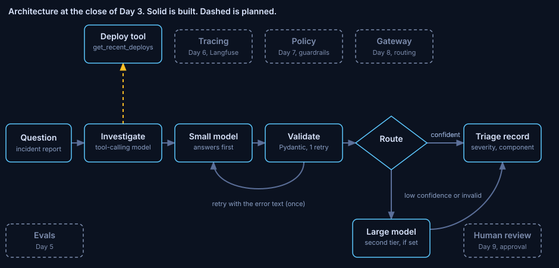

# ADR 0003: Store incident memory in Postgres with pgvector

Status: accepted. Written 2026-10-29, after the phase closed, from the phase notes, the changelog and the decision log.
Phase: Day 3. Code at close: commit `21b4c4a`. Run data: [notes/day3.md](../../notes/day3.md).

## Decision

Past incidents are stored as 800 embedded chunks in Postgres with pgvector. An ingestion job re-runs safely: an unchanged corpus writes 0 chunks.

## Diagnosis

Recall needs a store of past incidents and an ingestion job that can run twice.

The corpus is 200 synthetic incidents across 8 services and 20 failure patterns. 180 are originals and 20 are seeded twins: the same incident told in the other voice, dated 1 to 4 days later. Chunking by section gives 800 chunks of 384 dimensions.

## Guiding policies

1. Chunk by section: summary, timeline, root cause, remediation. 4 chunks per incident.
2. Hash every chunk. Embed only new or changed chunks. The hash covers the model, the embedded text and the date.
3. One transaction for upserts and deletes.
4. Search never reads `twin_of`, the answer key for Day 4.
5. Container images are pinned by digest, bound to 127.0.0.1 and scanned before first use.

## Coherent actions

- Done: Postgres with pgvector and Adminer, the synthetic corpus, the ingestion job, and a first search.
- Accepted risk (the learner, 2026-10-21): the `pgvector/pgvector:pg16` image has 8 unique Critical and 37 unique High findings, all in Debian base packages. Local only, synthetic data. Rescan when a digest moves.
- Next: Day 4 measures recall on all 20 pairs.

## Build, buy or adopt

Database: adopted. Postgres with pgvector 0.8.7.
Embedding model: adopted. `BAAI/bge-small-en-v1.5`, MIT, revision pinned.
Libraries: `psycopg` 3.3.6 (LGPL-3.0), `pgvector` 0.5.1 (MIT), `sentence-transformers` 6.1.0 (Apache-2.0).
Ingestion job and corpus generator: built.

## Staffing

No hire. One engineer and one AI assistant built the phase.

## What would change this

The HNSW index is not needed at 800 rows. A larger corpus changes that. Behaviour above 800 rows is not measured.

## Evidence

- First ingestion: 800 chunks in about 40 s on CPU, including the one-time model download. Re-run: written 0, deleted 0, unchanged 800, in 0.3 s.
- First query, "auth latency spike after certificate rotation": 5 certificate-rotation summaries at distances 0.089 to 0.157. 2 of 5 hits belong to a seeded pair.
- Query plan at 800 rows: a sequential scan took 1.27 ms. With the index forced it took 0.78 ms.
- Adminer 6.1.1: 0 Critical, 6 unique High, all in OS packages.

## Limits

Template text is more regular than real postmortems, so Day 4 recall is a ceiling. One query is close to a best case.
