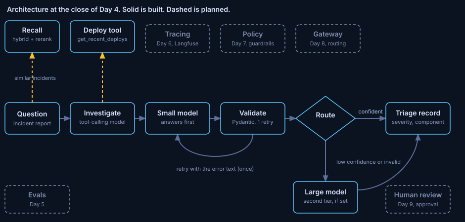

# ADR 0004: Retrieve with hybrid search and a reranker

Status: accepted. Written 2026-10-29, after the phase closed, from the phase notes, the changelog and the decision log.
Phase: Day 4. Code at close: commit `cd9283d`. Run data: [notes/day4.md](../../notes/day4.md).

## Decision

The recall step uses hybrid search (BM25 and vector, fused by reciprocal rank) followed by a cross-encoder reranker. It returns 3 incidents, ranked by their best chunk.

## Diagnosis

Vector search missed 3 of 10 exact-token queries in the top 5. recall@5 on token queries was 0.70.

On meaning queries all three retrievers reached recall@5 of 1.00. Hybrid and rerank lowered MRR there, because each failure pattern appears in about 9 incidents and a paraphrase matches all of them.

## Guiding policies

1. Pick the retriever by recall on a labelled set.
2. Pay latency where the gain is measured. Rerank adds 0.07 recall@5 (0.93 to 1.00), all of it on token queries.
3. Retrieve incidents, not chunks.
4. The recall node uses `hybrid_rerank` with k = 3.

## Coherent actions

- Done: three retrievers behind one interface, a 40-query labelled evaluation, and a recall node before the small model (order: recall, investigate, small).
- Open: near-twin incidents take 2 of 3 recall slots. Not built: removing near-duplicates before filling the prompt.

## Build, buy or adopt

BM25: adopted. `rank-bm25` 0.2.2, Apache-2.0, last release 2022-02-16, about 8.7 million downloads in the last month (pypistats, 2026-10-25).
Reranker: adopted. `BAAI/bge-reranker-base`, revision pinned.
Retriever interface and the evaluation: built.
Audit: 7 known vulnerabilities in packages this step did not touch (`filelock` 4.2.0, `setuptools` 84.0.0). Both updated with approval.

## Staffing

No hire. One engineer and one AI assistant built the phase.

## What would change this

A rerank pool that excludes the right candidate cannot be rescued. A larger corpus or a different latency budget reopens policy 2.

## Evidence

40 queries: 30 meaning, 10 exact-token. k = 5, CPU. The learner's run and the assistant's run matched on every quality number. Latencies below are the learner's run. The assistant's run gave 18, 18 and 356 ms.

| Retriever | recall@5 | MRR | p50 ms |
|---|---|---|---|
| vector | 0.93 | 0.823 | 14 |
| hybrid | 0.97 | 0.821 | 15 |
| hybrid_rerank | 1.00 | 0.781 | 341 |

Token queries: recall@5 0.70, 0.90, 1.00. Rerank costs about 341 ms per query against 14 ms, about 24 times the latency.

## Limits

40 queries. One query is 2.5 points, so differences of a few points are noise. Templated data. One writer for the meaning queries.
