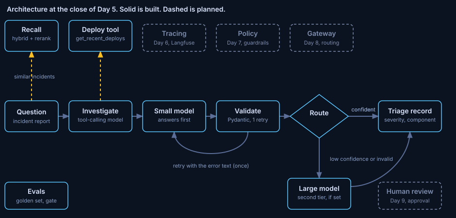

# ADR 0005: Gate releases on measured answer quality

Status: accepted. Written 2026-10-29, after the phase closed, from the phase notes, the changelog and the decision log.
Phase: Day 5. Code at close: commit `1e7f27a`. Run data: the Day 5 entries of [code/CHANGELOG.md](../../code/CHANGELOG.md), and `record/progress.json`. There is no `notes/day5.md`.

## Decision

A change that lowers answer quality fails the build. The gate scores 30 golden cases on 5 measures with a judge from a different model family, and compares them with a frozen baseline.

## Diagnosis

Unit tests assert one output per input. Model answers vary, and the system under test is not deterministic. Without a measured baseline a change that lowers quality ships unnoticed.

## Guiding policies

1. Own the judge metrics. No evaluation library. `ragas` 0.4.3 was rejected after `make audit` found PYSEC-2026-3046 with no fix and 31 new packages.
2. Golden cases are holdout: the case's own incident is removed from recall. 20 cases have a twin and 10 do not.
3. A failed judge call is excluded from the mean and counted. The gate fails above a failure-rate cap of 0.15.
4. The judge is a different model family from the answering model: Qwen2.5 7B judges Qwen3 4B-instruct.
5. A committed baseline gates every change. Floors sit at the baseline mean minus 0.05. Reports carry 95% bootstrap intervals and their provenance: judge digest, prompt hashes, golden hash, git SHA.
6. A `--no-recall` negative control exists. It can never be saved as a baseline. A failed gate never rewrites the baseline.

## Coherent actions

- Done: the golden set, the judge, the metrics, the runner, the gate, the baseline and the case viewer.
- Done: recalled incidents show their severity and remediation, and a fourth judged measure rates the proposed first action.
- Open: the learner's own check of three judged cases. The assistant's hand-check found faithfulness wrong once each way (g01 and g03).
- Open: answering quality of a router with two Qwen3 tiers is not tested.

## Build, buy or adopt

Evaluation harness: built.
Evaluation library: rejected, for the audit finding above.
Judge model: adopted. Qwen2.5 7B.
Answering model: adopted. Qwen3 4B-instruct, Apache-2.0, thinking off, temperature 0, 120 s timeout.

## Staffing

No hire. One engineer and one AI assistant built the phase. The work ran as parallel packages in git worktrees, and the lead ran the gate before any merge.
Add people when gates fail builds faster than anyone can investigate them, or when a second system shares the harness.

## What would change this

A judge measured against human labels, and a larger golden set, change the floors. Faithfulness is the noisiest measure and is the first to revisit.

## Evidence

Model comparison, one model answering all 30 cases, severity correct:

| Model | Severity | sev1 caught | Median time |
|---|---|---|---|
| Qwen3 4B-instruct | 25 of 30 | 6 of 8 | 4.6 s |
| Qwen3 8B | 26 of 30 | 7 of 8 | 7.9 s |
| Qwen2.5 7B | 20 of 30 | 2 of 8 | 3.4 s |
| Qwen2.5 1.5B | 10 of 30 | 2 of 8 | not recorded |

The 4B-instruct result is inside the noise of the 8B, at 2.5 GB against 5.2 GB.

Final run (commit `9a4d12c`): severity 0.77 [0.60, 0.90], faithfulness 0.79, context recall 0.93, action quality 0.92, response relevancy 0.67 with 3 judge failures. The paired incident was recalled in 19 of 20 twin cases.

Control with recall off: severity 0.17, action quality 0.10, faithfulness 0.00, context recall 0.00. The gate failed with 8 problems, 4 floors and 4 regressions, and exited 1.

Two workers gave no speedup: 428.1 s serial, 431.7 s parallel.

## Limits

30 cases, synthetic, local models. One run is an anecdote: severity moved from 25 to 23 of 30 for the same model, inside the noise. The run data for this phase is in the Day 5 entries of `code/CHANGELOG.md` and the log in `record/progress.json`.
