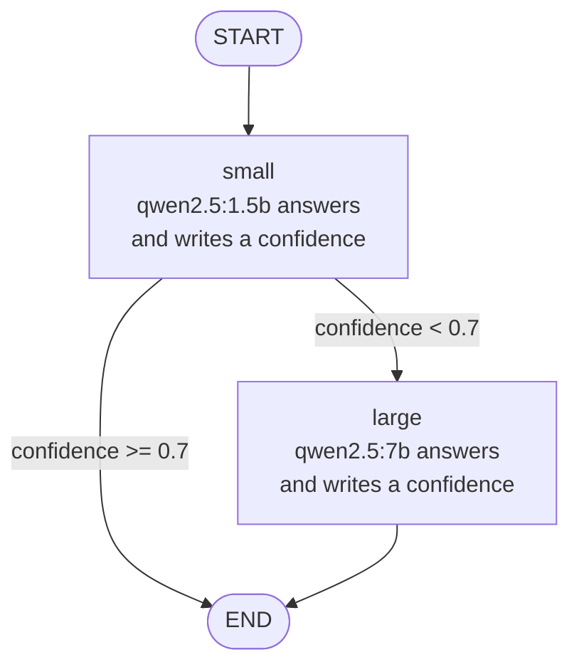

# Router graph

Small model first. The larger model runs only when the small one is not confident.

## State carried between nodes

- `question`
- `answer`
- `confidence`
- `model_used`

## Notes

- Source: `app/graph.py`. The threshold is `THRESHOLD = 0.7`.
- Drawn by hand. LangGraph's own `draw_mermaid()` omits the `small -> large` and `large -> END` edges, because `route()` has no return type annotation. Routing was checked with stubbed model answers: confidence 0.2 ran `small` then `large`, confidence 0.9 ran `small` only.
- Confidence is the number the model writes in its answer. It is not an Ollama score and has no fixed range.
